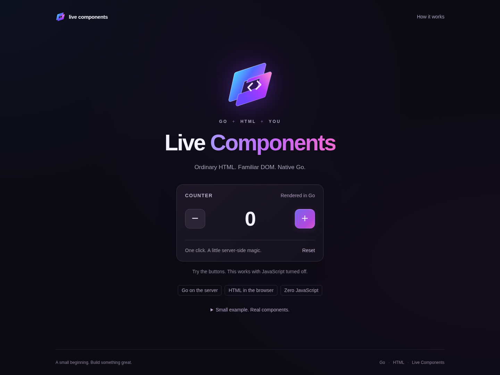

# Live Components

Manipulate server-side HTML in Go using familiar DOM operations.

```sh
go get github.com/renniemaharaj/live-components
```

Import as `live "github.com/renniemaharaj/live-components"`:

```go
page, err := live.Parse(`<button id="count">0</button>`)
if err != nil {
    return err
}

page.GetElementById("count").SetTextContent("1")
html := page.Render()
```

## Try the counter

A small Go + HTML starter with increment, decrement, and reset. Works without
JavaScript, with [go-api-kit](https://github.com/renniemaharaj/go-api-kit) serving
the page and form requests.



With Go 1.25.3 or newer, clone both repositories side by side:

```sh
git clone https://github.com/renniemaharaj/live-components.git
git clone https://github.com/renniemaharaj/go-api-kit.git
cd live-components
go run ./examples/counter
```

Open **http://127.0.0.1:9121**.

## Examples

- [Counter starter](examples/counter/README.md): forms, DOM updates, and HTML responses.
- [Live Components Lab](examples/stress/README.md): component previews, stress tests, and benchmarks.

Each example has its own screenshot, setup instructions, and explanation.

## Documentation

See the [API guide](docs/api.md) for selectors, traversal, mutations, and rendering,
and the [API review](docs/api-review.md) for design and compatibility notes.

## License

[MIT](LICENSE).
