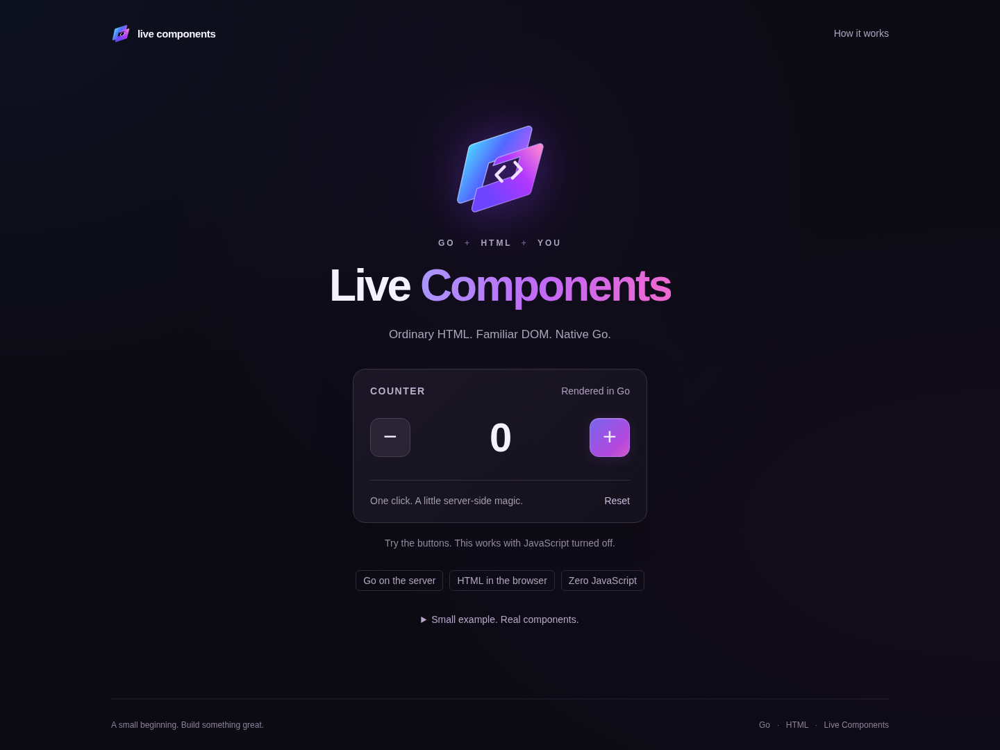

# Counter starter



A small Live Components example: ordinary HTML, go-api-kit, and a counter that
works without JavaScript. When JavaScript is enabled, a small optional runtime
updates just the count and its hidden state container. The page uses the cyan,
purple, and pink brand palette.

The examples use the sibling `../go-api-kit` checkout through their own Go module.
Go 1.25.3 or newer is required. The root `go.work` keeps these commands usable from
the repository root without adding HTTP toolkit dependencies to the core library:

```sh
go run ./examples/counter
```

Open **http://127.0.0.1:9121**. To choose another address:

```sh
go run ./examples/counter -addr 127.0.0.1:9200
```

WebSocket is the default browser transport. Use **http://127.0.0.1:9121/?transport=http**
for request-based updates, or use the links below the counter to choose either.
Both modes use native form submission when JavaScript is disabled.

## How it works

- `index.html` is ordinary HTML, embedded with its CSS, SVG logo, and app script.
- go-api-kit registers the page, form, WebSocket, and asset routes.
- The plus, minus, and reset buttons submit an HTML form to `POST /counter`.
- `/live.js` serves the optional ES module from `livehttp.RuntimeHandler()`.
- In HTTP mode, the app submits the form through `update()`, which requests JSON.
  Go applies the action to a fresh tree and responds with `livehttp.WriteUpdates`.
- In WebSocket mode, `connect()` opens `/counter/live` once. Go keeps a count and
  rendering tree for that connection, pushes initial state, and processes each
  incoming action in order. `livews.WriteUpdates` sends subsequent fragments.
- Both modes send just the inner HTML of `count` and `counter-state`.
  The latter is the smallest container around the hidden count input. The form,
  buttons, and surrounding page retain their existing browser nodes.
- HTTP submissions are queued so each one uses the preceding count. WebSocket
  actions contain only the action name; the connection owns the current count.
- Without JavaScript, Go redirects to `/?count=1` and the GET handler renders the
  complete page with `h.Render(http.StatusOK, page)`.

The counter retains the kit's environment-driven middleware and built-in `/health`
endpoint. The kit documents the timeout as its second default middleware; the
example exempts only `/counter/live` from that buffering timeout so Gorilla can
upgrade the connection. Rate limiting, authentication, and other defaults stay
active. The WebSocket uses a 1 KiB message limit, pooled write buffers, 10-second
write deadlines, 25-second pings, and a 60-second pong deadline. GET and HEAD are
registered explicitly for ordinary routes. The server retains the `-addr` flag.

Native submissions redirect to prevent form resubmission on refresh. Fragment
updates leave the URL unchanged. The count is carried in the hidden form field
and, after native redirects, the URL. It is intentionally editable, with no
database or cookies. HTTP requests own fresh trees, and each WebSocket owns its
count and reusable tree. Separate visitors never share a counter. Changes never
write back to the template, and restarting at `/` starts from zero. Counts are
signed 32-bit integers.

Edit the HTML, CSS, or Go handler and restart `go run` to rebuild embedded assets.
There is no frontend build step or live-reload dependency. The shared runtime
does not intercept forms or preserve inputs; it fetches or receives explicit
inner HTML updates. Form submission is application code in `static/app.js`.
Connections do not automatically reconnect or replay actions. On disconnect,
reload to start a new connection or choose HTTP mode.

Check the core library and both examples from the repository root:

```sh
go test ./... ./examples/...
go test -race ./... ./examples/...
go vet ./... ./examples/...
```
